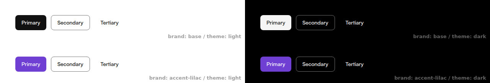

# Hirobius Design System

[](https://www.npmjs.com/package/@hirobius/design-system) [](https://hirobius-design-system.vercel.app/docs) [](LICENSE) [](https://github.com/hirobius/hds/actions/workflows/ci.yml)

Token-first React components with checked contrast and focus.

[](https://hirobius-design-system.vercel.app/docs)

**Live:** <https://hirobius-design-system.vercel.app/docs> (components, tokens and live demos)

HDS (Hirobius Design System) is a React component library on a DTCG token pipeline. The tokens compile to CSS variables and TypeScript constants. Four root attributes re-skin every component, with no JavaScript.

AI agents design and build HDS. Automated checks gate their work: typecheck, lint, token and WCAG contrast checks, tests and a consumer build.

<!-- auto:start:front-door-counts -->

- **64** public component modules, exported from `src/index.ts`
- **589** DTCG tokens in `hirobius.tokens.json`, compiled to CSS variables and TypeScript constants

<!-- auto:end:front-door-counts -->

The long form (core set, adoption, theming, Figma sync, accessibility) is in [docs/OVERVIEW.md](docs/OVERVIEW.md).

## Install

```bash
pnpm add @hirobius/design-system react react-dom
```

npm and yarn work too. `react-router` is an optional peer. To upgrade, follow [UPGRADING.md](UPGRADING.md).

## Usage

```tsx
import '@hirobius/design-system/tokens.css';
import '@hirobius/design-system/fonts.css'; // optional brand fonts
import { Button } from '@hirobius/design-system';

// data-hds scopes the base styles
export const App = () => (
  <div data-hds>
    <Button>Get started</Button>
  </div>
);
```

Theming, scoping and the router seam: [docs/CONSUMING.md](docs/CONSUMING.md).

## Structure

- `src/`: the components, the patterns and the token styles.
- `hirobius.tokens.json`: the DTCG token source. `accents/` and `directions/` hold the brand variants.
- `content/` and `docs-site/`: the docs pages and the Next.js site that renders them.
- `figma/`: the one-way sync from code to the Figma library.
- `mcp/`, `skills/` and `codemods/`: the MCP server, the agent skill and the upgrade codemods that ship in the package.
- `scripts/`: the token pipeline, the generators and the check scripts.
- `tests/` and `fixtures/`: the unit, contract and visual tests, and the fixtures that prove each check fires.
- `docs/`: engineering notes, decision records (`docs/adr/`) and agent rules (`docs/agent/`).

## For AI agents

- **MCP server:** the package ships `hds-mcp` (stdio, no network). Add it to your MCP client from an app that has the package installed: `{ "mcpServers": { "hds": { "command": "npx", "args": ["hds-mcp"] } } }`
- **llms.txt:** [llms.txt](llms.txt) ships in the package. It is also online at <https://hirobius-design-system.vercel.app/llms.txt>.
- **AGENTS.md:** [AGENTS.md](AGENTS.md) has the rules for agents that build with HDS.
- **Skill:** `npx skills add hirobius/hds --skill hds-consumer`

## Contributing

Issues and pull requests are welcome. [CONTRIBUTING.md](CONTRIBUTING.md) has the setup, the check command and the PR flow. Agents that work in this repo start at [docs/ai/FRONT-DOOR.md](docs/ai/FRONT-DOOR.md).

## License

[MIT](LICENSE) © Adrian Milsap. The embedded Sora and IBM Plex Mono fonts use the SIL Open Font License 1.1 ([NOTICE.md](NOTICE.md)).
