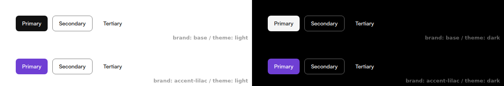
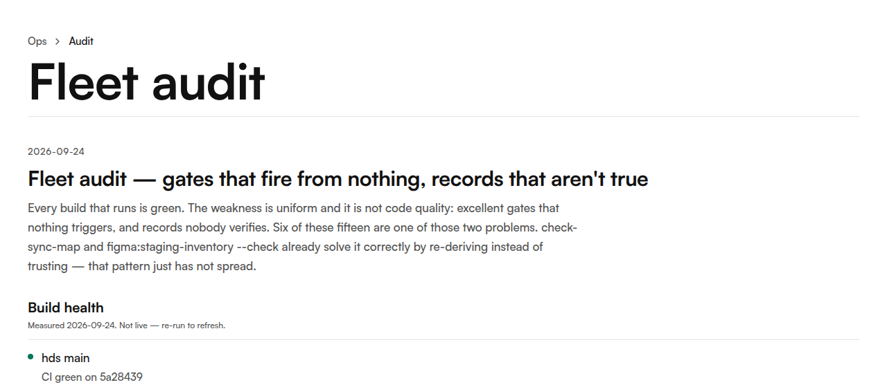

# Hirobius Design System

[](https://github.com/hirobius/hds/actions/workflows/ci.yml) [](https://www.npmjs.com/package/@hirobius/design-system) [](https://hirobius-hds-components.vercel.app)

HDS is a governed, token-first React design system: components plus the system
around them — a DTCG token pipeline (CSS variables + TypeScript constants),
quality gates in git hooks and CI, one-way Figma sync, and WCAG-checked
contrast and focus. Live docs: <https://hirobius-hds-components.vercel.app>

```bash
pnpm add @hirobius/design-system
```

Upgrading: [UPGRADING.md](UPGRADING.md) lists what each release asks of you. From 0.22.0, `npx @hirobius/design-system@latest upgrade` does it for you.

[](https://hirobius-hds-components.vercel.app)

<!-- auto:start:front-door-counts -->

- **62** public component modules, exported from `src/index.ts`
- **474** DTCG tokens in `hirobius.tokens.json`, compiled to CSS variables and TypeScript constants

<!-- auto:end:front-door-counts -->

What the system includes:

- **Token pipeline.** DTCG tokens in `hirobius.tokens.json` compile to CSS variables and TypeScript constants through a validated alias chain, with AA-contrast gates in light and dark.
- **Gates with proof-of-firing.** Typecheck, zero-warning ESLint, token validity and contrast, Vitest tests and a consumer smoke build run in git hooks and CI; many gates carry passing and violating fixtures that prove they catch what they describe.
- **Upgrade path.** A release ledger and one consumer command: `npx @hirobius/design-system@latest upgrade`.
- **One-way Figma sync.** Code is the source of truth; tokens project into Figma, and `pnpm check:figma-drift` compares a committed snapshot against the model.
- **Theming without JavaScript.** Four root attributes (theme, density, brand, font) re-skin HDS descendants through CSS variables.

The counts are generated by `pnpm readme:counts`; `scripts/__tests__/front-door.test.mjs` fails if this README claims more than the source has.

[How HDS is engineered](docs/ENGINEERING.md) walks the token pipeline, the quality gates (and how they're proven to fire), testing, release and upgrade, and Figma sync.

Agents: install the consumer skill with `npx skills add hirobius/hds --skill hds-consumer` (see `docs/CONSUMING.md`, "Agent skill").

## In use

<!-- auto:start:consumer-usage -->

An internal operations dashboard is one of 2 product apps that use components: **33** of its source files import from `@hirobius/design-system`, using **24** distinct components. The screenshot below is a page of that app, rendered from its `main` branch.

| Consumer kind     | Count | How it uses HDS                           |
| ----------------- | ----- | ----------------------------------------- |
| Product apps      | 2     | Components and tokens                     |
| Token-level sites | 4     | Tokens and CSS only, no component imports |

Month-by-month adoption in each product app, one row per measured commit: [docs/ADOPTION.md](docs/ADOPTION.md).

[](docs/images/product-app-audit.png)

<!-- auto:end:consumer-usage -->

The numbers come from `pnpm consumer:usage --root <consumer checkout>`, which measures that checkout's `src/` and records its commit in `docs/data/consumer-usage.json` (pass `--commit <sha>` for a `git archive` export); without a root it reuses the committed snapshot. A deprecated alias counts as the component it points to (`HdsCheckbox` as `Checkbox`); `promptContracts` — components that page- and video-clone prompts tell generated code to import — are listed in that file but not counted here, and `scripts/__tests__/consumer-usage.test.mjs` fails if this section drifts from the snapshot. The product-app / token-level split is a declared figure in that file, confirmed 2026-10-01 and updated 2026-10-12 when Roleforge became the second product app (`consumersConfirmed` there is true).

## What belongs in the system

<!-- auto:start:core-set -->

**47** components are the core set: the brand-neutral, composable surface every HDS screen is built from, and the part of the system that has to be excellent. Import them from the package root; each carries `core: true` in `public/hds-manifest.json`.

- **Actions:** `Button`
- **Display:** `Avatar`, `Card`, `EmptyState`, `Field`, `Icon`, `Kbd`, `Table`, `Timeline`
- **Feedback:** `Alert`, `Badge`, `Progress`, `Skeleton`, `Spinner`, `ToastProvider`
- **Inputs:** `Checkbox`, `Combobox`, `Input`, `Radio`, `SegmentedControl`, `Select`, `Slider`, `Tag`, `Textarea`, `Toggle`
- **Layout:** `Box`, `Container`, `Disclosure`, `Divider`, `Grid`, `Stack`, `Surface`
- **Navigation:** `Breadcrumb`, `InlineLink`, `NavList`, `Pagination`, `Tabs`
- **Overlays:** `CommandPalette`, `Dialog`, `Menu`, `Popover`, `Tooltip`
- **Theming:** `HdsRouterProvider`, `HdsThemeProvider`
- **Typography:** `MetaLine`, `Text`
- **Utility:** `VisuallyHidden`

**14** pattern modules ship from `@hirobius/design-system/patterns`, and only from there: composed surfaces that assume a product (page shells, forms, code blocks, page sections), built from the core set. One name per module; its parts and props types come with it.

`AppShell`, `AssetImg`, `AsyncState`, `CodeBlock`, `DataTableSection`, `DestructiveSection`, `ErrorPattern`, `Form`, `FormActions`, `MetricTiles`, `Page`, `PageHeader`, `Reveal`, `StatusTile`

The package root also exports the rest of the allow-list (compound parts, and the components outside the core set; the [consumer skill](skills/hds-consumer/SKILL.md) lists them by category): reach for the core set first. 0.20.0 removed the root re-exports of the pattern modules, the docs internals and 13 components that fold into a survivor ([MIGRATIONS.md](MIGRATIONS.md#0200-removals-2026-10-01)). Deprecated, exported only until removed: `CardMetric` (removed in 1.0.0), `MetricTile` (removed in 1.0.0), `MetricTiles` (removed in 1.0.0), `Stat` (removed in 1.0.0), `StatusTile` (removed in 1.0.0).

Every component's disposition (core, pattern, fold or internal) is in the [architecture doc](docs/hds-architecture-2026-09-18.html), ratified 2026-09-26 in [hds#254](https://github.com/hirobius/hds/issues/254); [ADR-031](docs/adr/031-core-set-and-dispositions.md) records the decision and what has changed since.

<!-- auto:end:core-set -->

This section is generated by `pnpm readme:counts` from `scripts/lib/core-components.mjs`, `src/patterns.ts` and the manifest; `scripts/__tests__/core-set.test.mjs` fails if it drifts from them.

## Using the published package

HDS ships to the public npm registry as `@hirobius/design-system` (ESM). It needs
no `.npmrc`, token or registry config. Full guide:
[docs/CONSUMING.md](docs/CONSUMING.md).

> **Not on GitHub Packages.** The **Packages** sidebar still shows a frozen
> `@hirobius/design-system` entry from before publishing moved to the public
> npm registry in [#39](https://github.com/hirobius/hds/pull/39). Always
> install from npm:
> **[npmjs.com/package/@hirobius/design-system](https://www.npmjs.com/package/@hirobius/design-system)**.

The short version:

```bash
npm install @hirobius/design-system react react-dom
# react-router is an OPTIONAL peer — only if you want HDS links to drive your router
```

```tsx
// once at the app root — full bundle: tokens + theme + utilities
import '@hirobius/design-system/tokens.css';
import '@hirobius/design-system/fonts.css'; // optional: the HDS brand fonts
import { Button } from '@hirobius/design-system';

// add data-hds to the root (or any section) so the scoped base styles apply
export const App = () => (
  <div data-hds>
    <Button>Get started</Button>
  </div>
);
```

No router, Tailwind config, or font files needed. With a router, inject it once
via `<HdsRouterProvider>`. See **[docs/CONSUMING.md](docs/CONSUMING.md)** for the
router seam, `data-hds` scoping and MUI coexistence.

### Theming: the four dials

HDS theming runs on root attributes and CSS variables, so it needs no JavaScript.
Set them on any element (React, Astro, plain HTML) and every HDS descendant
re-skins:

| Dial    | Attribute / var                                | Values          | Default                           |
| ------- | ---------------------------------------------- | --------------- | --------------------------------- |
| theme   | `data-theme`                                   | `dark`          | light (unset)                     |
| density | `data-density`                                 | `compact`       | comfortable (unset)               |
| brand   | `data-brand` (+ `data-tenant` alias)           | overlay slug    | base (unset)                      |
| font    | `--hds-font-family` / `--hds-font-family-mono` | any font-family | Plus Jakarta Sans / IBM Plex Mono |

Set them in static markup (zero-JS, e.g. an Astro layout) or from React with the
optional `<HdsThemeProvider>`, and read them back with `useHdsTheme()`. Worked
examples of both: [docs/CONSUMING.md](docs/CONSUMING.md).

## Figma ↔ code

Code is the source of truth, and sync runs one way, from code to Figma. What exists today:

- **Tokens → Figma model:** `pnpm figma:model` projects `hirobius.tokens.json` into `figma/model.json`: the Primitives, Semantic (Light/Dark), Component, Role, Brand and Density collections, plus text and effect styles; Light and Dark keep their own values.
- **Model → Figma file:** `pnpm figma:push` applies that model to a Figma file and `pnpm figma:native-import` writes DTCG files for Figma's own Variables ▸ Import. Both run by hand; no workflow pushes to Figma. Runbook: [`figma/README.md`](figma/README.md).
- **Figma → repo:** `pnpm figma:snapshot --ingest` records the file's state in `figma/snapshot.json`; `pnpm check:figma-drift` compares the model against it. A hand edit in Figma is drift, not a source change.
- **Legacy export:** `pnpm figma-variables` still writes the older plugin and REST export files, projected from the same model.
- **Components → Code Connect:** the v2 templates live in the repo, but no mapping is published (that needs a Figma Organization plan), so Dev Mode shows no snippets.

What each Figma plan allows, and the Pro-plan architecture this follows, are in [ADR-025](docs/adr/025-figma-sync-pro-architecture.md).

## Developing this repo

```bash
pnpm install
# Generated data files are gitignored; create them once (the same step CI runs):
node scripts/generate-manifest.mjs && node scripts/generate-component-api.mjs && node scripts/enrich-manifest.mjs && node scripts/sync-icons.mjs && node scripts/audit-tokens.mjs --full
pnpm docs:dev   # docs site (component pages with live demos)
```

```bash
pnpm test              # pretest gates + unit + contract tests, exactly as the pre-push hook and CI run them
```

The full gate list is under [Verification workflow](#verification-workflow).

## Architecture

Three structural rules: **strict semantics** (public surfaces prefer system
primitives such as `Stack`, `Grid`, `Surface` and `Text` over raw layout divs or
ad hoc CSS), **polymorphism** (primitives preserve semantic HTML while staying
composable through governed APIs such as `forwardRef`, `as` and layout slots),
and a **12-column grid** (readable center columns, intentional breakout zones,
explicit `gap` ownership). The reasoning lives in
[docs/ENGINEERING.md](docs/ENGINEERING.md).

Source-of-truth files:

- `hirobius.tokens.json`: token values and alias chain.
- `public/hds-manifest.json`: machine-readable system inventory, metadata, and docs linkage.
- `src/app/data/component-api.json`: generated prop tables and reflected component API.
- `DESIGN.md`: lean visual spec for agents and engineers.
- `DESIGN-HANDOFF.md`: verbose visual mirror for handoff and review.

Component dispositions (core, pattern, fold, internal) are decided in the [architecture doc](docs/hds-architecture-2026-09-18.html) and recorded in [ADR-031](docs/adr/031-core-set-and-dispositions.md); [What belongs in the system](#what-belongs-in-the-system) lists the result.

Component-by-component Figma links live in [docs/DESIGN_LINKS.md](docs/DESIGN_LINKS.md), generated by `pnpm figma:links`.

## Accessibility

What CI and the hooks check today, and nothing more:

- **Contrast:** `scripts/check-contrast.mjs` enforces WCAG AA contrast on the core token pairs, in light and dark. It runs in CI and the pre-commit hook.
- **Lint:** `jsx-a11y` rules run inside ESLint with zero warnings allowed.
- **Focus:** `scripts/check-focus-states.mjs` (`pnpm check:focus`) audits focus styles on interactive components. It runs in `pretest` under `pnpm test`, so in the pre-push hook and in CI, and passes with 0 violations.
- **Docs site:** `scripts/check-docs-axe.mjs` (`pnpm check:docs-axe`, after `pnpm docs:publish`) scans the live demo of every `/docs/components/*` and `/docs/patterns/*` page in light and dark, scoped to the demo frame so the Fumadocs chrome does not count. CI fails on serious or critical violations outside `scripts/docs-axe-allowlist.json` (empty).

Screen-reader output is checked by `tests/primitive-contracts/screen-reader.contract.test.tsx` (in `pnpm test`), which walks Dialog, Menu, Select, Combobox, Table and Alert with a virtual screen-reader (`@guidepup/virtual-screen-reader`) under jsdom and asserts the role, name and state phrases it reads, including the alert's live-region announcement. It reads the jsdom accessibility tree, not a real desktop or mobile screen-reader.

## Visual direction: Editorial Enterprise

The governing direction is "Editorial Enterprise": enterprise rigor with editorial pacing — sharp hierarchy, open whitespace, monochrome neutrals, a single tenant-set accent. Documentation reads like a designed publication; cards are used sparingly (whitespace, rails, dividers and bands carry structure first); motion is used only where it clarifies. The full visual spec is [DESIGN.md](DESIGN.md).

## Verification workflow

The gates are deterministic and need no browser or live site:

- **pre-commit** (`.husky/pre-commit`): secrets scan (when `gitleaks` is installed locally), Prettier on staged files, typecheck, zero-warning ESLint, and token validity and contrast.
- **pre-push** (`.husky/pre-push`): the tiered gate (`scripts/pre-push-gate.mjs`; full tier: `pnpm check:fast`, `pnpm test` (the pretest gates, then Vitest unit and contract tests), then the consumer smoke build (library build, subpath resolution, publint, consumer typecheck); smaller diffs run a lighter tier, see `scripts/lib/gate-tier.mjs`).
- **CI** (`.github/workflows/ci.yml`): a gitleaks scan over the full history, the pre-push checks, plus bundle budgets and the docs-site build with its axe gate.
- **Visual review:** the docs site (`docs-site/`) is the visual verification surface: every core component and pattern has a page with a live demo, `check-docs-axe` gates its accessibility.

`CLAUDE.md` is the operating contract for agents working in this repo.

## Open explorations

Work in progress, shown as it stands — questions the system is still testing,
not features it promises.

### Delight directions

Could HDS be more playful without losing its discipline? A static page renders
three directions, subtle to bold, on the current tokens with page-scoped
overrides, and measures token reach and AA contrast for each:
[`docs/explorations/2026-10-delight/index.html`](docs/explorations/2026-10-delight/index.html).
No token has changed.

### Agent consistency

Can the public docs alone make different agents build the same screen? Three
agents build one Client-detail screen from the docs, and `pnpm eval:consistency`
compares the results: builds, token violations, axe, component-set overlap
(Jaccard) and pixel diff. Today it runs the offline half over a directory of
apps (`pnpm eval:consistency -- --apps <dir> --offline`: violations and Jaccard
from source only). Spec, thresholds and ledger:
[`eval/consistency/`](eval/consistency/README.md). The latest recorded run, as
printed by `pnpm eval:consistency -- --summary`:

```text
Agent consistency 2026-10-31 (harness, design-system 0.32.0): FAIL - builds 2/3, violations 0, axe 0, Jaccard min 1 (limit >= 0.85), light diff not measured (an app did not build)
```

The latest run still misses a threshold, and they stay where they are: the useful
output is where the agents diverge, which points at the docs to fix next. The
eval measures the docs; it does not gate merges or constrain how agents work.

## Bundle and release hygiene

- `pnpm check:size` builds the library bundle and runs `size-limit`.

Releases are cut locally with [Changesets](https://github.com/changesets/changesets): a pull request that changes the published package adds a changeset (`pnpm changeset:add`). The flow is in [docs/RELEASING.md](docs/RELEASING.md).

## Repository shape

```text
src/                  components (app/), theme context, generated token constants, styles
  brand/ form/ mui/ scroll/   subpath entry points
hirobius.tokens.json  the single token source
scripts/              generators and gates
codemods/             the upgrade command and its codemods
mcp/                  the MCP server shipped in the package
docs-site/ content/   the documentation site and its pages
eval/                 agent-consistency eval
docs/                 ADRs, ENGINEERING.md, guardrail registry
public/               manifest, llms.txt
```

## Primary docs

- [`docs/CONSUMING.md`](docs/CONSUMING.md): installing & using the published package
- [`docs/ENGINEERING.md`](docs/ENGINEERING.md): how the system is built (pipeline, gates, release, Figma sync)
- [`docs/ai/FRONT-DOOR.md`](docs/ai/FRONT-DOOR.md): the front door for agents working in this repo; [`AGENTS.md`](AGENTS.md) is the guide for agents building with the package
- `CLAUDE.md`: agent operating contract
- `TOKEN_GOVERNANCE.md`: token system rules
- `docs/guardrails/registry.json`: gate registry; `docs/state-surfaces.json`: every file that describes state

## License

The HDS code is MIT ([LICENSE](LICENSE)). The package CSS also embeds the Plus Jakarta Sans and IBM Plex Mono fonts, which keep their own licenses and are not covered by MIT. See [NOTICE.md](NOTICE.md).
