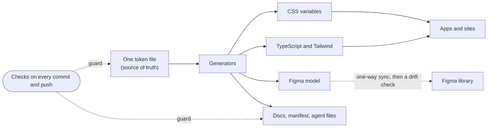

## The problem

One person builds many apps: an operations dashboard, a job-application tracker, client and personal sites. Each new app asked the same questions again. What spacing? Which grey? How does a disabled button look? How does a dialog trap focus?

Every app answered them a little differently. The answers drifted, and each one cost time that should go to the product.

A component library alone does not fix this. Every design system has a Button. The hard part is the system around the components: one source for every value, checks that keep it true, a design file that matches the code, and an upgrade path for the apps that use it.

## The limits

- **One owner.** There is no team to review by hand. Quality must come from checks that run without anyone remembering them.
- **Agents write most of the code.** The owner sets the direction and makes the calls. Agents build, test and review. The system must stay readable to them and catch their mistakes.
- **No hosted CI.** Every check runs on the machine that makes the change, before the push. A check that only runs in the cloud does not run.
- **A small Figma plan.** Design-tool access is rationed by the day, so syncing design and code must be cheap and deliberate.
- **Before 1.0.** Breaking changes are allowed, but each one ships with an upgrade note and, where it can, a codemod.

## The architecture

### Tokens are the source of truth

Every color, size, space, radius, type and motion value lives once, in one token file in the W3C design-token format. Generators turn it into CSS variables, TypeScript constants, a Tailwind config, the Figma model and these docs. Nobody edits a generated file. A value changes in one place and reaches every output in the same build.

Tokens come in four tiers: primitive values, semantic roles, component settings and named roles. A new brand changes tokens, not components.

### Code wins, and Figma follows

Sync runs one way. The code projects the tokens into a Figma model. A person applies it to the library file, and a snapshot of the file comes back into the repo. A drift check compares the snapshot with the model. When Figma and code disagree, code is right and Figma is fixed.

This removed the hardest question in design-system work, "which one is correct?", and replaced it with a diff.

### Checks must be seen to fail

Each rule is a small script that checks one thing. Every script is in one registry that names where it fires: on every commit, on every push, or on demand. A check that never fails proves nothing, so most checks ship with a passing and a failing example, and a meta-check confirms each one rejects the failing example.

Budgets are fixed. When a size or performance budget fails, the code gets smaller. The budget does not get larger.

### The docs are generated from the code

This site replaced a hosted component workshop. Component pages, prop tables, token tables and the accessibility contracts are read from the code when the site builds. The site is also checked: accessibility, layout shift and touch-target size run against the built pages.

### Agents drive, the owner decides

The owner decides what to build, for whom, and when. That includes money, anything public and anything that cannot be undone. Agents decide how: structure, tooling, tests and refactors. They report each call in a line or two so the owner can reverse it.

No change merges on the word of the agent that wrote it. A second, independent review must pass on the exact commit first. Releases and Figma library publishes stay with the owner.

## The results

These numbers are read from the repo when this page builds.

<CaseStudyFacts />

One before-and-after: the published package once shipped about 49 MB in about 400 files, because the build copied images, fonts and source maps into it. It now ships about 0.55 MB in about 207 files.

## What is next

- **Publish the Figma library**, so designers use the same components the code ships.
- **Prove design and code match**: a blocking check on any component mismatch between Figma and code, and fewer variants per component, with Button first.
- **Open the repo to the public**, after a full scan of the history and the package for secrets.
- **A short walkthrough** of the system, from a token change to a shipped release.
