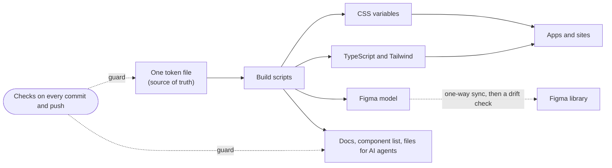

## The walkthrough

About 80 seconds, no sound. A script records it from the built docs site, so it can be re-made after a change instead of filmed by hand. The terminal panels show real command output from the repo on the day it was recorded, so the version and counts in the video can be older than the ones on this page.

<WalkthroughVideo />

## The problem

One person builds many apps: an operations dashboard, a job-application tracker, client and personal sites. Each new app asked the same questions again. What spacing? Which grey? How does a disabled button look? How does a dialog trap focus?

Every app answered them a little differently. The answers drifted, and each one cost time that should go to the product.

A component library alone does not fix this. Every design system has a Button. The hard part is the system around the components: one source for every value, checks that keep it true, a design file that matches the code, and an upgrade path for the apps that use it.

## The limits

- **One owner.** There is no team to review by hand. Quality must come from checks that run without anyone remembering them.
- **Agents write most of the code.** The owner sets the direction and makes the calls. Agents build, test and review. The system must stay readable to them and catch their mistakes.
- **Checks run before the push.** Git hooks (scripts Git runs before a commit or a push) run the checks on the machine that makes the change. The hosted build pipeline runs one job: it publishes a release when a change merges.
- **A small Figma plan.** Design-tool access is rationed by the day, so syncing design and code must be cheap and deliberate.
- **Before version 1.0.** Breaking changes are allowed, but each one ships with an upgrade note and, where possible, a script that rewrites the app's code for you.

## The architecture

### Tokens are the source of truth

A design token is a named value, such as a color or a spacing step. Every color, size, space, radius, type and motion value lives once, in one token file in the W3C design-token format, an open standard. Build scripts turn it into CSS variables, TypeScript constants, Tailwind settings, the Figma model and these docs. Nobody edits a generated file. A value changes in one place and reaches every output in the same build.

Tokens come in four tiers: raw values, roles such as "page background", settings for single components, and named roles. A new brand changes tokens, not components.

### Code wins, and Figma follows

Sync runs one way. The code projects the tokens into a Figma model. A person applies it to the library file, and a snapshot of the file comes back into the repo. A drift check compares the snapshot with the model. When Figma and code disagree, code is right and Figma is fixed.

This removed the hardest question in design-system work, "which one is correct?", and replaced it with a diff.

### Checks must be seen to fail

Each rule is a small script that checks one thing. Every script is listed in one registry that says when it runs: on every commit, on every push, or on demand. A check that never fails proves nothing, so most checks ship with a passing and a failing example, and a meta-check confirms each one rejects the failing example.

Budgets are fixed. When a size or performance budget fails, the code gets smaller. The budget does not get larger.

### The docs are generated from the code

This site replaced Storybook, a hosted component workshop. Component pages, prop tables, token tables and the accessibility contracts are read from the code when the site builds. The site is also checked: accessibility, layout shift (content jumping as the page loads) and touch-target size run against the built pages.

### Agents drive, the owner decides

The owner decides what to build, for whom, and when. That includes money, anything public and anything that cannot be undone. Agents decide how: structure, tooling, tests and refactors. They report each call in a line or two so the owner can reverse it.

No change merges on the word of the agent that wrote it. A second, independent review must pass on the exact commit first. Releases and Figma library publishes stay with the owner.

## The results

These numbers are read from the repo when this page builds, so they match the latest release.

<CaseStudyFacts />

The repository is public, so anyone can read the code and the history behind these numbers.

One before-and-after: up to version 0.5, the published package was about 49 MB in about 400 files, because the build copied site images, fonts and source maps into it. Version 0.5 cut it to about 0.55 MB.

## What is next

- **Publish the Figma library**, so designers use the same components the code ships.
- **Prove design and code match**: a check that blocks a release when a component differs between Figma and code, and fewer variants per component, starting with Button.
