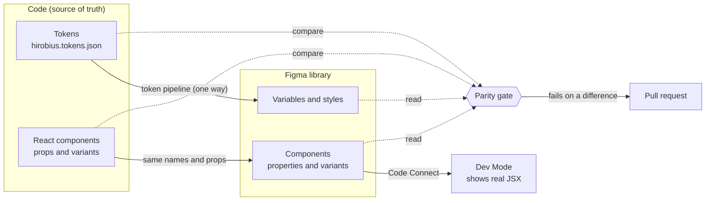

A designer picks `Button`, sets `Variant` to `primary` and `Size` to `lg`. A developer should be able to write that button without translating anything. HDS keeps the two sides aligned with seven pieces. Code is the source of truth for all of them, and a check fails when the two sides differ.



| Piece                                         | What it does                                                                | Where it lives                               |
| --------------------------------------------- | --------------------------------------------------------------------------- | -------------------------------------------- |
| [Same names and props](#same-names-and-props) | A Figma property is a real prop, with the same option names.                | The component source and the Figma library   |
| [Token pipeline](#token-pipeline)             | Sends token values to Figma variables. One way, from code.                  | `hirobius.tokens.json` and `pnpm figma:push` |
| [Code Connect](#code-connect)                 | Maps each Figma component to its React component, props and variants.       | `*.figma.ts` templates in the repo           |
| [Parity gate](#parity-gate)                   | Reads the whole library, compares it with code and fails on a difference.   | `pnpm check:figma-parity`                    |
| [Lint plugin](#lint-plugin)                   | Flags code that leaves the system.                                          | `@hirobius/design-system/eslint-plugin`      |
| [Codemods](#codemods)                         | Rewrite your code when a name or prop changes.                              | `npx @hirobius/design-system upgrade`        |
| [Agent skill](#agent-skill)                   | Tells an AI coding agent which components to use and how to check its work. | `skills/hds-consumer` in the package         |

## Same names and props

The Figma library draws the React components under the same names. Its properties follow one contract:

| In code                                    | In Figma                                                                    |
| ------------------------------------------ | --------------------------------------------------------------------------- |
| A variant prop (`variant`, `tone`, `size`) | A variant property in Title Case. Its options are the code values.          |
| A string prop or `children`                | A text property (`Label`, `Title`)                                          |
| A boolean prop                             | A boolean property. A visibility toggle is named `Show …`.                  |
| An icon slot (`iconLeft`)                  | An instance swap that holds an Icon, with a `Show …` toggle                 |
| Hover, focus and pressed                   | A `State` variant. These have no prop; a `disabled` option sets `disabled`. |

So `Size=lg` in Figma is `size="lg"` in code.

## Token pipeline

A token is written once, in `hirobius.tokens.json` (the W3C design tokens format). Everything else is built from it:

1. The build writes the CSS variables, the Tailwind theme and the TypeScript types.
2. `pnpm figma:push` writes the same values to Figma variables. A variable has the path of its token. Light and dark are modes of one collection; density and brand are modes of their own collections.
3. `figma/snapshot.json` records what Figma holds after the push.
4. `pnpm check:figma-drift` compares the tokens with the snapshot: a missing variable, an extra one or a different value in any mode is drift.

Sync runs one way. A value changed by hand in Figma is drift, not a change to the system. A release does not publish while there is drift.

## Code Connect

[Code Connect](https://www.figma.com/code-connect-docs/) is the Figma feature that shows real component code in Dev Mode in place of generated CSS. HDS has a Code Connect template for <CodeConnectCount /> library components. A template reads the properties of the selected instance and prints the JSX for it:

```tsx
// Figma: Button, Variant=primary, Size=lg, Show icon=true
<Button variant="primary" size="lg" iconLeft={<Plus />}>
  Save
</Button>
```

A prop that equals its default is left out, so the snippet is what a developer would write by hand.

The templates are generated, not written by hand:

1. `figma/reads/component-properties.json` records the properties each Figma component has, read from the live library.
2. `figma/code-connect.json` says how each property maps to a prop.
3. `pnpm figma:connect:generate` writes one `<component>.figma.ts` template for each entry.

`pnpm figma:connect:check` then fails when:

- an entry does not match the properties Figma has (a renamed option, a new property);
- a code variant has no Figma option and no recorded reason;
- a snippet, for any combination of properties, does not type-check against the component's real props.

The check renders every combination. The result for each component is in [`figma/code-connect-preview.txt`](https://github.com/hirobius/hds/blob/main/figma/code-connect-preview.txt).

**Status.** The templates are checked, but they are not published to Figma yet. Publishing Code Connect needs a Figma Organization or Enterprise plan, and the HDS library is on a Professional plan. Every library component has a basic mapping in the repo (its import and source file), and the components with a template also have their props and variants.

## Parity gate

The pieces above each cover one link. The parity gate checks the whole picture: it reads the library and compares it with code.

```bash
pnpm check:figma-parity
```

| It compares                                           | A difference it reports                                     |
| ----------------------------------------------------- | ----------------------------------------------------------- |
| Each Figma component with a React component           | A component only one side has, or two different names       |
| Each variant property with a prop                     | An option code does not accept, a value Figma does not draw |
| Each other property (text, boolean, instance swap)    | A property with no prop and no recorded reason              |
| The Figma icons with the code icon set                | An icon only one side has                                   |
| Each variable collection with the snapshot and tokens | A value changed in Figma, or a collection no token builds   |

How it works:

1. Two read-only scripts read the library: the properties of every component, and one hash for each variable collection. The result is a committed file, `figma/parity/read.json`. Nothing in CI can read Figma on a Professional plan, so the read is refreshed on purpose (`pnpm figma:parity --emit-read`).
2. The gate compares the read with the component manifest, the Code Connect registry and the tokens.
3. Each difference is a line with a severity and the side that fixes it (code or Figma). The gate prints a parity score: checks passed out of checks made.
4. A difference that is known and waits for a fix is an entry in `figma/parity/baseline.json`, with a reason and an issue. The gate fails on any other difference. It also fails when an entry's difference is gone, so the list only gets shorter.

There are <ParityKnownCount /> known differences now. The gate runs in `pnpm test`.

## Lint plugin

The lint plugin checks the code side. It flags raw hex colours, raw pixel spacing, raw `<button>` and `<input>`, nested cards, and imports of deprecated or removed exports. A screen that passes uses the same components and tokens the Figma file does.

```js
import hds from '@hirobius/design-system/eslint-plugin';

export default [...hds.configs.recommended];
```

The rules and an example of each are in the [plugin README](https://github.com/hirobius/hds/blob/main/scripts/eslint-plugin-hds/README.md).

## Codemods

When a release renames a component, a prop or a token, a codemod makes the same change in your code:

```bash
npx @hirobius/design-system@latest upgrade
```

It applies each release in order, bumps the dependency, runs your typecheck and lists what is left to do by hand. In Figma, a component removed from code moves to the Archive page and is not deleted, so existing designs keep working. See [Upgrade](/docs/guides/upgrade).

## Agent skill

An AI coding agent that builds from a Figma frame needs the same answers a developer does. The package ships a skill, `hds-consumer`, generated from the component manifest for the installed version. It lists the components the agent may import, how to lay out a screen, what is deprecated, and the lint step to finish with. The upgrade command refreshes it.

With the [MCP server](/docs/guides/agents#mcp-server), the agent looks up a component's props on demand. Because Figma and code share names, the property names it reads from a Figma frame are the prop names it looks up.

## Where to go next

- [Built for agents](/docs/guides/agents) for the MCP server, `AGENTS.md` and `llms.txt`.
- [Tokens](/docs/guides/tokens) for the token tiers and how to consume them.
- [Upgrade](/docs/guides/upgrade) for the codemods.
