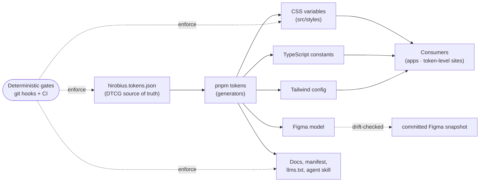

# How HDS is engineered

HDS is a governed, token-first React design system: the components, plus the
system that keeps them correct. This document explains how it is built — where
values come from, how quality is enforced rather than reviewed, how it ships,
and how design and code stay in sync. It is the engineering companion to the
usage-focused [README](../README.md) and the visual spec in
[`DESIGN.md`](../DESIGN.md).

The whole system rests on one idea: **a single source of truth, everything else
generated, and deterministic gates that make drift impossible.**

## Architecture at a glance



## 1. The token pipeline — one source of truth

Every color, space, radius, type and motion value lives once, in
`hirobius.tokens.json`, in the [W3C DTCG](https://www.w3.org/community/design-tokens/)
format, and the files generated from it are never hand-edited. (A small set of
layout and utility values — section spacing, `clamp()` layout helpers — still
lives in `src/styles/theme.css`, outside the token file.) `pnpm tokens` compiles
that source, through a validated alias chain, into every consumable form:

- **CSS custom properties** (`src/styles/tokens.generated.css`) — the runtime contract.
- **TypeScript constants** — the same values, typed, for JS consumers.
- **A Tailwind config** projected from the tokens, so utility classes resolve to
  the same variables.
- **The Figma model** (see §6) and the **docs** — `DESIGN.md`,
  `DESIGN-HANDOFF.md`, the machine-readable `public/hds-manifest.json`,
  `llms.txt`, and the consumer agent skill — all regenerated from the same run.

Because the outputs are _generated, not maintained_, a value changes in exactly
one place and propagates everywhere at once; the generated files cannot drift
from the source, because a build replaces them. The pipeline also validates as
it goes — `audit-tokens` rejects forbidden overrides and ghost variables, and
`check-typography-discipline` keeps type off ad-hoc overrides.

Governance rules for the token layer are in
[`TOKEN_GOVERNANCE.md`](../TOKEN_GOVERNANCE.md).

## 2. Quality gates — correctness is enforced, not reviewed

HDS does not rely on a reviewer remembering the rules. Each invariant is a small,
single-purpose script, and every one is registered in
[`docs/guardrails/registry.json`](guardrails/registry.json) with where it fires,
so the set is auditable. The gates that guard the shipped contract run
automatically, in three tiers:

- **Every commit** (`.husky/pre-commit`) — a deliberately lean set that keeps
  commits fast: types, zero-warning lint, token validity and contrast, the type
  ramp, and the generated sync map.
- **Every push and every PR** — `pnpm test` runs its `pretest` chain of gates
  (manifest, deprecations, focus states, docs, the upgrade ledger) before the
  unit and contract tests, then a consumer smoke build.
- **CI only** — Figma drift, bundle budgets, and accessibility on the docs site.

The rest of the registry is **on demand**: audits you run when you need them
(`pnpm check:full` runs the full set), kept out of the hooks on purpose. What the
automatic gates prevent, by example:

- **`check-contrast`** blocks any token change that drops a text/background pair
  below WCAG AA — checked in both light and dark, on every commit.
- **`check-type-ramp`** rejects font sizes and weights that fall off the type
  ramp, on every commit, so type can't quietly fork into one-off values.
- **`check-upgrade-ledger`** fails the push and CI when a consumer-facing change
  has no upgrade note (§5), so the migration path can't fall behind the code.
- **`check-figma-drift`** fails CI when a hand edit in Figma diverges from the
  code model, keeping code the single source of truth (§6).

### Proof-of-firing: who tests the tests

A gate that has quietly stopped working is worse than no gate — it reports green
while the invariant rots. HDS's answer is that most gates (not yet all) ship with
**both a passing fixture and a violating fixture**, and a meta-check
(`validate-fixture-proof-of-firing`) walks the registry and asserts that each
pair exists and that the gate actually _rejects_ the violating one. Today that
meta-check runs by hand rather than in CI; wiring it in, and giving every gate a
fixture pair, is open work.

The registry rules are documented in
[`docs/guardrails/SCHEMA.md`](guardrails/SCHEMA.md).

## 3. Testing

- **Unit tests** cover token math, generators, and component logic (Vitest and
  `node:test`).
- **Contract tests** (`tests/primitive-contracts/`) assert the behavior a
  primitive promises — keyboard interaction, polymorphism, and screen-reader
  output, the last driven by a virtual screen-reader that walks Dialog, Menu,
  Select, Combobox, Table and Alert and checks the role, name, and state phrases
  they announce.
- **A consumer smoke build** installs the packed library the way a real consumer
  would and verifies subpath resolution, `publint`, and a consumer-side
  typecheck — so "it builds here" also means "it works when installed."
- **The docs themselves** are tested by the agent-consistency eval — see §4.

## 4. The docs are tested too: agent-consistency eval

Most design systems test their components. HDS also tests whether its
_documentation_ works: whether someone with no tribal knowledge — here, an AI
agent — can read the public docs and use the system correctly.

**How it works.** Three agents, each in a fresh context with no shell or web
access, get only the inputs a real consumer would have (the screen spec, the
package's `AGENTS.md`, its type definitions) and build the same screen. That
isolation is a run protocol (frozen in `eval/consistency/CONDITIONS.md`), not
something the harness enforces. The harness never calls a model itself; it
scores the generated apps
(`pnpm eval:consistency`) against fixed thresholds:

| Measure                                                 | Threshold |
| ------------------------------------------------------- | --------- |
| Builds and type-checks on the first try                 | 3 of 3    |
| Raw hex, px, Tailwind, raw HTML controls, or custom CSS | 0         |
| axe serious/critical violations, light and dark         | 0         |
| Component-set overlap (Jaccard), every pair             | ≥ 0.85    |
| Pixel difference at 1280px, every pair                  | ≤ 1.5%    |

If three independent readers of the docs build the same screen the same way,
the docs are unambiguous. If they diverge, the divergence points at exactly
where the docs are unclear.

**Where it stands — honestly.** The baseline run passed builds, violations and
accessibility, but **missed the overlap and pixel thresholds**, and the
thresholds are deliberately not softened to make it pass. The divergence was
diagnosed cause by cause: the largest was discoverability — one agent never
found the import path for the higher-level page patterns and rebuilt them by
hand from primitives — followed by several components that each plausibly fit
the same need. Each cause got a targeted fix in the agent-facing docs: an
explicit imports list in `AGENTS.md`, import paths in every MCP answer, and a
"pick by need" guide that names the right component _and_ the wrong one agents
reached for.

Method and frozen run conditions: [`eval/consistency/`](../eval/consistency/README.md)
· results over time: [`ledger.json`](../eval/consistency/ledger.json) · the
cause-by-cause analysis:
[`DIAGNOSIS-2026-10-05.md`](../eval/consistency/DIAGNOSIS-2026-10-05.md).

## 5. Shipping and the consumer upgrade path

Releases are cut with [Changesets](https://github.com/changesets/changesets): a
PR that changes the published package adds a changeset, and on a push to `main`
`.github/workflows/release.yml` opens a "Version Packages" PR whose merge
publishes to public npm with provenance.

Upgrading a design system normally breaks its consumers. HDS codifies the
migration instead of documenting it and hoping: every consumer-facing change
records a machine-readable **upgrade note**, a release **ledger** accumulates
them, and a single command runs the migration for the consumer:

```bash
npx @hirobius/design-system@latest upgrade
```

## 6. Design ↔ code sync (Figma)

Code is the source of truth, and sync runs **one way**. `pnpm figma:model`
projects `hirobius.tokens.json` into a Figma model (primitives, semantic
Light/Dark, component, role, brand and density collections). `check-figma-drift`
compares that model against a committed snapshot of the Figma file, so a hand
edit made in Figma surfaces as _drift_ rather than silently becoming a second
source of truth. The push into Figma is run by hand — no workflow writes to
Figma. The full rationale and plan limits are in
[ADR-025](adr/025-figma-sync-pro-architecture.md).

## 7. Theming without JavaScript

The visual system re-skins through four root attributes — `data-theme`,
`data-density`, `data-brand`, and a font variable — read as CSS variables, so a
theme, density, brand overlay, or typeface applies to every HDS descendant with
**zero JavaScript**, equally in React, Astro, or plain HTML. The React
`<HdsThemeProvider>` is a typed convenience over the same attribute contract,
not a requirement. See [Theming in the README](../README.md#theming-the-four-dials).

## Further reading

- [`README.md`](../README.md) — install and use the published package.
- [`docs/CONSUMING.md`](CONSUMING.md) — consumer guide.
- [`TOKEN_GOVERNANCE.md`](../TOKEN_GOVERNANCE.md) — token-layer rules.
- [`docs/guardrails/registry.json`](guardrails/registry.json) — the gate/guardrail registry.
- [`docs/adr/`](adr/) — architecture decision records.
- `CLAUDE.md` — the operating contract for agents working in this repo.
